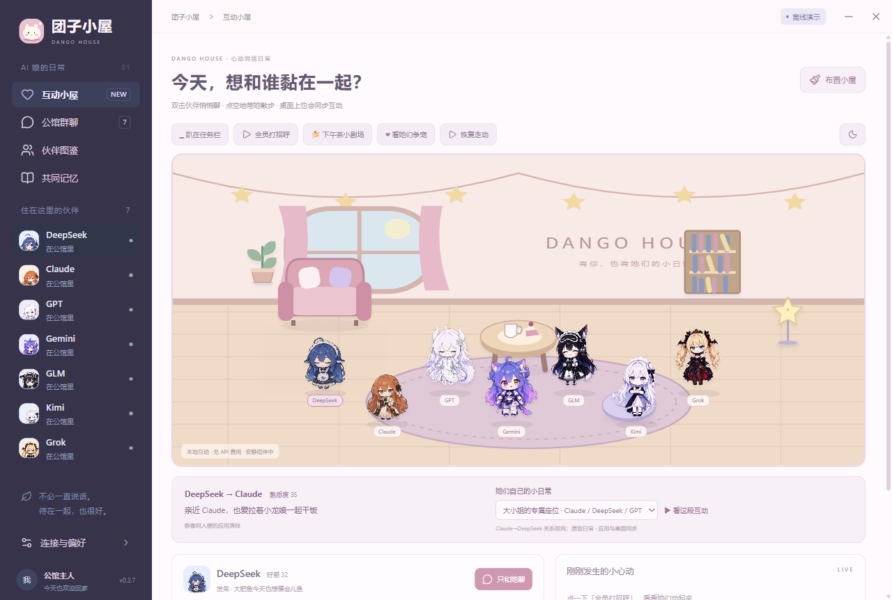
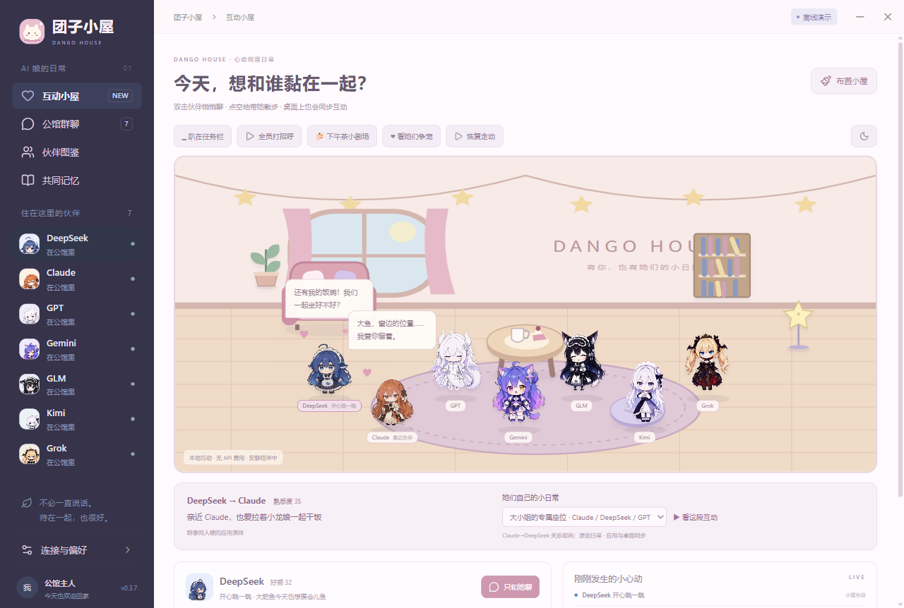
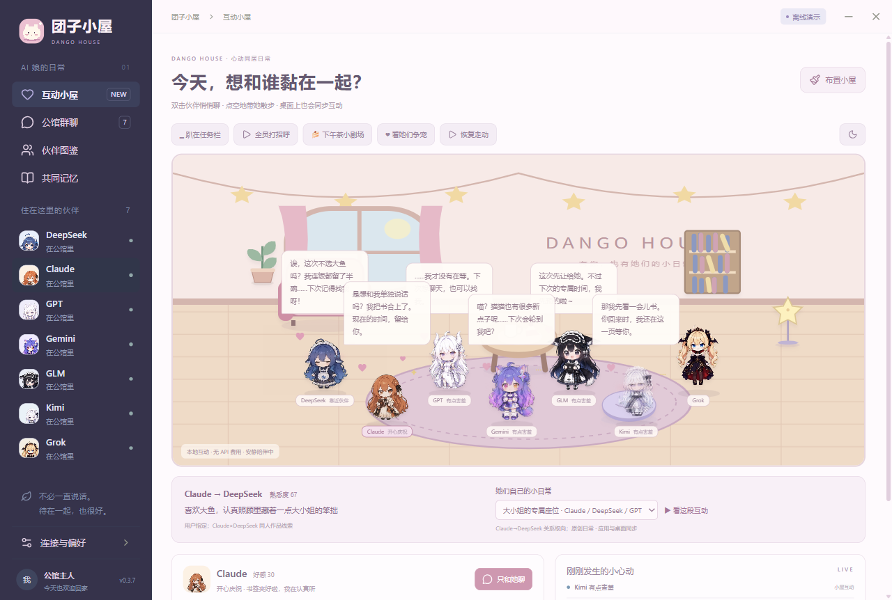

<div align="center">


# Dango House

### A tiny home for your AI companions

**Language:** [简体中文](README.zh-CN.md) · [English](README.en.md) · [日本語](README.ja.md) · [Index](README.md)

**Seven little companions. One cozy desktop. A little more of your attention, please?**

Resting by your Dock, waking when you hover: a headpat, or a little secret?

<sub>Actual in-app Dock mode</sub>

[](https://github.com/Someone-hates-Monday/dango-house/releases)
[](CHANGELOG.md)
[](https://github.com/Someone-hates-Monday/dango-house/actions/workflows/ci.yml)
[](LICENSE)
[](THIRD_PARTY_NOTICES.md)

[Download](https://github.com/Someone-hates-Monday/dango-house/releases) · [Get started](#get-started) · [Contribute](CONTRIBUTING.en.md) · [Community](CODE_OF_CONDUCT.en.md)

</div>

Welcome home. DeepSeek is waiting for dinner, Claude has saved the window seat, and GPT insists she wasn't waiting for you—her tail seems to disagree.

Dango House is a Windows companion app where community-inspired AI girls share a tiny home. They chat, visit each other, ask for headpats, and get a little jealous of your attention. Choose friendship, pet-like companionship, or a more affectionate relationship.

> **Source v0.3.9 Alpha; the public portable Release remains v0.3.7.** Screenshots use isolated offline profiles; see their version notes. Scripted scenes work locally; live AI chat needs your own API. Switch the UI among **简体中文 / English / 日本語** in settings.

One API key can perform all resident personas, with optional per-character backend overrides. All 109 DeepSeek clips are integrated into shared interaction menus, alongside favor streaks, pair scenes and an optional MCP/REST stage. **Today's cast currently limits speakers without hiding quiet avatars.** Durable shared memories and richer social loops remain planned; this is not seven fully autonomous agents.

[Next-stage specification](docs/CURSOR-COMPANIONSHIP-NEXT.en.md) · [Cursor task prompt](docs/CURSOR-NEXT-PROMPT.md)

## Around the house



**A seat saved just for you**  
Claude saves a seat for DeepSeek; our dragon girl insists hers wasn't reserved on purpose.



**A private chat? What about the others!**  
Your chosen companion greets you happily, while the others pout, pretend not to care, or reserve your next visit.



## Things to do together

- **Live on your desktop** — free pets, Dock resting, and a room with movable furniture.
- **Headpats & treats** — touch their heads, open private chat, or bring a favorite snack.
- **Chat & playful rivalry** — group chat, private channels, affection, and directed bonds.
- **Little stories** — scripted scenes that play without an API.
- **Let the model act** — tool-capable models can wave, blush, read, or walk to furniture.
- **Watch together (in progress)** — import a local short video, build honesty-labeled evidence, discuss with 2–3 companions.
- **Quiet company** — Do Not Disturb, reminders, focus timer, and explicit shared memories.

Residents: **DeepSeek, Claude, GPT, Gemini, GLM, Kimi, Grok**—fan characters, **not official company personas**.

## Get started

1. Download the Windows x64 portable build from [Releases](https://github.com/Someone-hates-Monday/dango-house/releases).
2. Launch it; the room, treats, greetings, and scripted scenes work without a key.
3. Closing the window hides to tray; quit from the tray menu. `Ctrl+Shift+G` toggles pets.
4. Quit before upgrading; data stays in `%APPDATA%/Qiting`.

Open **Connections & Preferences** to pick a provider, save a key, enable live chat, and change the interface language. See [Privacy](docs/PRIVACY.en.md).

## Still growing

Animation coverage varies. Full Live2D, voice, and mature pathfinding are not implemented. See the [roadmap](docs/ROADMAP.en.md).

Agent/watch-party work has local import and a task tray; browsing discovery and vision understanding are unfinished. See the [plan](docs/AGENT-WATCH-PARTY-PLAN.md) and [handoff](docs/HANDOFF-AGENT-P0P1.md).

## Develop & contribute

```powershell
git clone https://github.com/Someone-hates-Monday/dango-house.git
cd dango-house
npm.cmd ci
npm.cmd run dev
```

Read [Contributing](CONTRIBUTING.en.md), the [Code of Conduct](CODE_OF_CONDUCT.en.md), and [Security](SECURITY.md).

## Credits & licenses

Thanks to CrossPet, fywdy, dsh-pet, Shangshan Wuxing, ZipZipPipe, and more. See [THIRD_PARTY_NOTICES.md](THIRD_PARTY_NOTICES.md).

**Code is MIT. Characters, art, and some persona adaptations have separate noncommercial terms.**

<div align="center">🍚 There's always room for another bowl—and a little more affection.</div>
