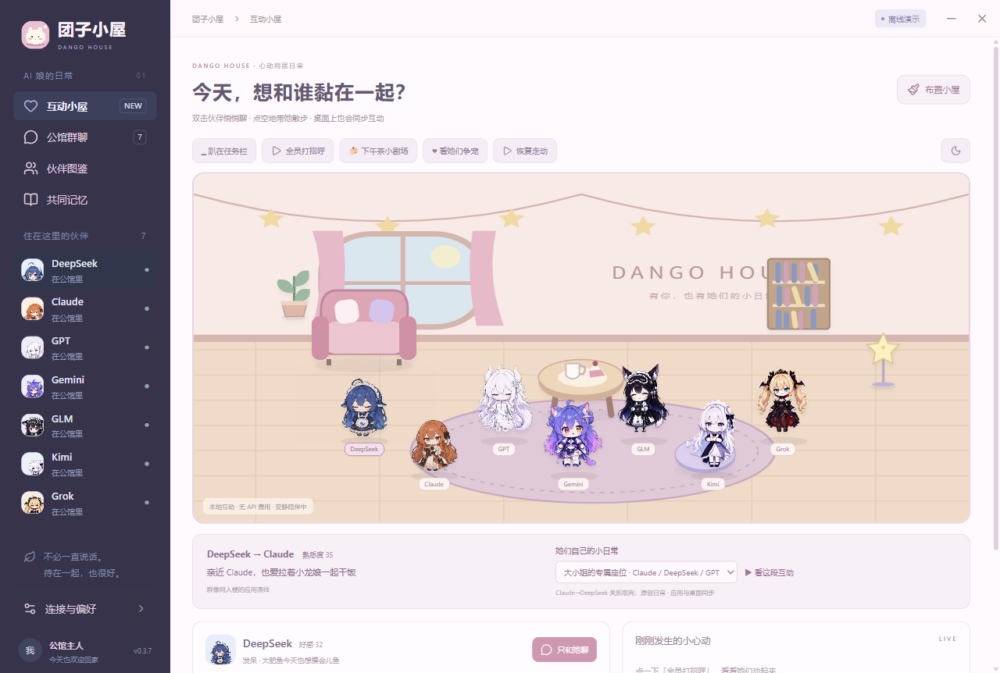
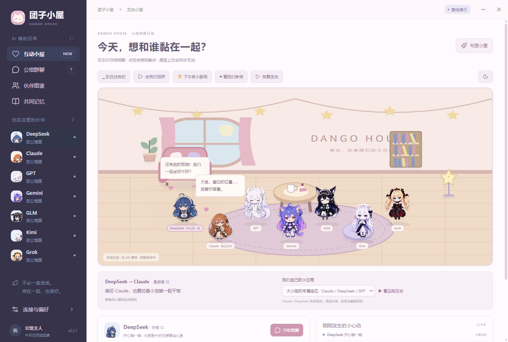

<div align="center">


# 団子小屋 · Dango House

### AI 娘の小さな住まい

**言語：** [简体中文](README.zh-CN.md) · [English](README.en.md) · [日本語](README.ja.md) · [索引](README.md)

**七つの団子と、一枚のデスクトップ。今日も、少しだけひいきしてほしい。**

Dock に伏せて寄り添い、マウスが近づくと立ち上がる——なでなでか、内緒話か。

<sub>実際のアプリの Dock モード</sub>

[](https://github.com/Someone-hates-Monday/dango-house/releases)
[](CHANGELOG.md)
[](https://github.com/Someone-hates-Monday/dango-house/actions/workflows/ci.yml)
[](LICENSE)
[](THIRD_PARTY_NOTICES.md)

[ダウンロード](https://github.com/Someone-hates-Monday/dango-house/releases) · [はじめかた](#はじめかた) · [貢献](CONTRIBUTING.ja.md) · [コミュニティ](CODE_OF_CONDUCT.ja.md)

</div>

おかえり。DeepSeek はごはん待ち、Claude は窓辺の席を残していて、GPT は「待ってなんかいない」と言う——でも尻尾がばらしてしまう。

団子小屋は Windows 向けの寄り添いアプリです。コミュニティ発の AI 娘たちが同じ小屋で暮らし、おしゃべりしたり、なでなでしてもらったり、少しだけ争寵したりします。

> **ソースは v0.3.9 Alpha、公開ポータブル Release は v0.3.7 です。** オフラインデモでも遊べます。本番チャットには自分の API が必要です。「接続と設定」で **简体中文 / English / 日本語** を切り替えられます。

一つの API Key で全員のキャラクターを演じられます。DeepSeek の 109 動画、短いペア劇、任意の MCP/REST 接続を統合しました。現在の人数設定は発言を制限しますが、休憩中の姿は非表示になりません。継続的な共有記憶と豊かな交流は[次の段階](docs/CURSOR-COMPANIONSHIP-NEXT.en.md)で実装する予定です。

## お部屋の様子



**とっておきの席**  
Claude は DeepSeek のために席を残し、竜娘は「わざとじゃない」と言い張ります。



**今日は彼女だけ？ほかの子は？**  
選ばれた子は喜んで迎え、ほかの子は性格どおりに拗ねたり、次の約束を取ったりします。

## いっしょにできること

- **デスクトップに住む** — フリー桌寵、Dock 待機、模様替えできる部屋。
- **なでなでとおやつ** — 頭をなでたり、内緒話したり、好きなおやつを渡したり。
- **会話と小さな争寵** — みんなの会話、専用チャンネル、好感度、関係性。
- **小さな劇** — API なしで遊べる内製シーン。
- **モデルに動いてもらう** — `perform_action` で手を振ったり本を読んだり。
- **いっしょに短い動画を見る（開発中）** — ローカル動画の取り込みと、正直な被覆ラベル付きの議論。
- **静かな寄り添い** — おやすみモード、リマインダー、集中タイマー、明示メモリー。

住人は **DeepSeek、Claude、GPT、Gemini、GLM、Kimi、Grok**。コミュニティ二次創作であり、**各社公式人格ではありません**。

## はじめかた

1. [Releases](https://github.com/Someone-hates-Monday/dango-house/releases) から Windows x64 ポータブル版を入手。
2. 起動。Key なしでも部屋・おやつ・歓迎・ローカル劇が楽しめます。
3. ウィンドウを閉じるとトレイへ。終了はトレイメニュー。`Ctrl+Shift+G` で桌寵の表示切替。
4. データは `%APPDATA%/Qiting`。

**接続と設定** でプロバイダ・Key・本番チャット・表示言語を設定します。詳細は [プライバシー](docs/PRIVACY.ja.md)。

## これからの小屋

動作の完成度はキャラごとに差があります。Live2D 一式や音声などは未実装。[ロードマップ](docs/ROADMAP.ja.md) を参照。

Agent / いっしょに見る：ローカル取り込みとタスクトレイはあり、ブラウズ探しと視覚理解は未完。[計画](docs/AGENT-WATCH-PARTY-PLAN.md) と [引き継ぎ](docs/HANDOFF-AGENT-P0P1.md)。

## 開発と貢献

```powershell
git clone https://github.com/Someone-hates-Monday/dango-house.git
cd dango-house
npm.cmd ci
npm.cmd run dev
```

[貢献ガイド](CONTRIBUTING.ja.md)、[コミュニティ規約](CODE_OF_CONDUCT.ja.md)、[セキュリティ](SECURITY.md) を先に読んでください。

## クレジットとライセンス

CrossPet、fywdy、dsh-pet、上善无形、ZipZipPipe ほかに感謝。[THIRD_PARTY_NOTICES.md](THIRD_PARTY_NOTICES.md) を参照。

**コードは MIT。キャラ・美術・一部の人柄には別の非商用条件があります。**

<div align="center">🍚 ごはんも、すきも、もう一杯どうぞ。</div>
