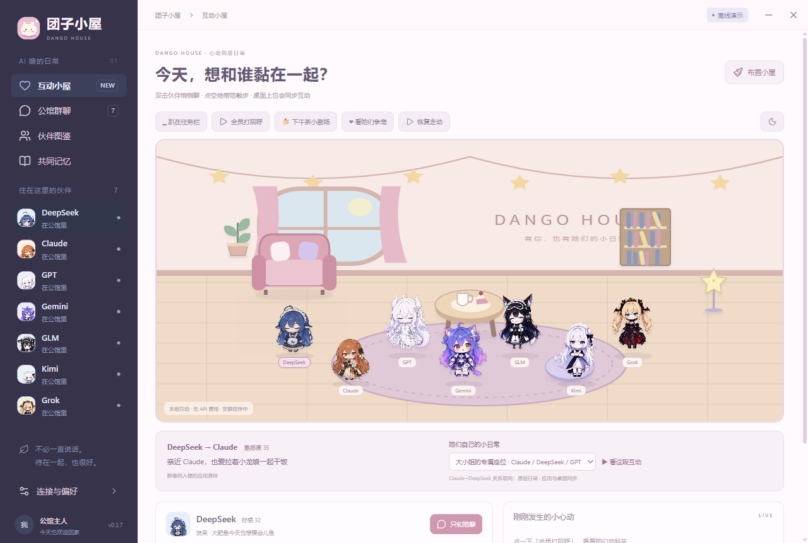
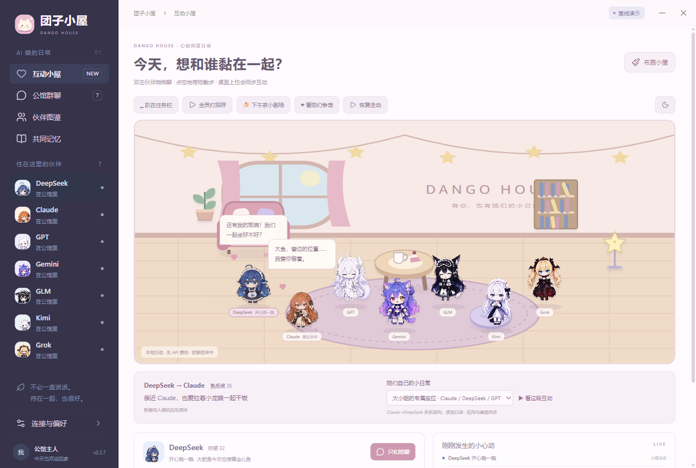
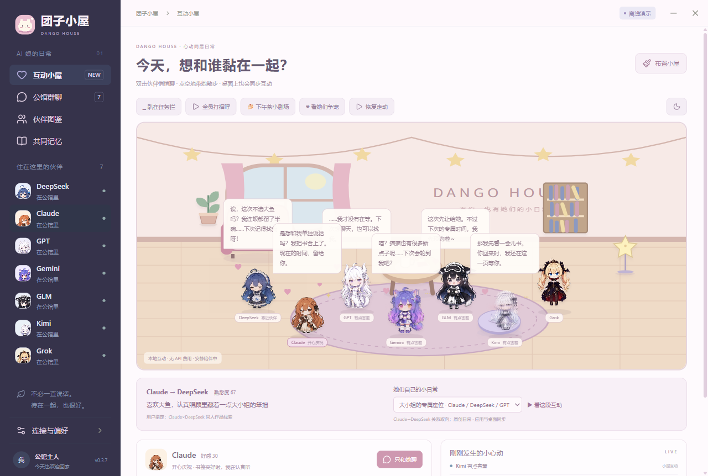
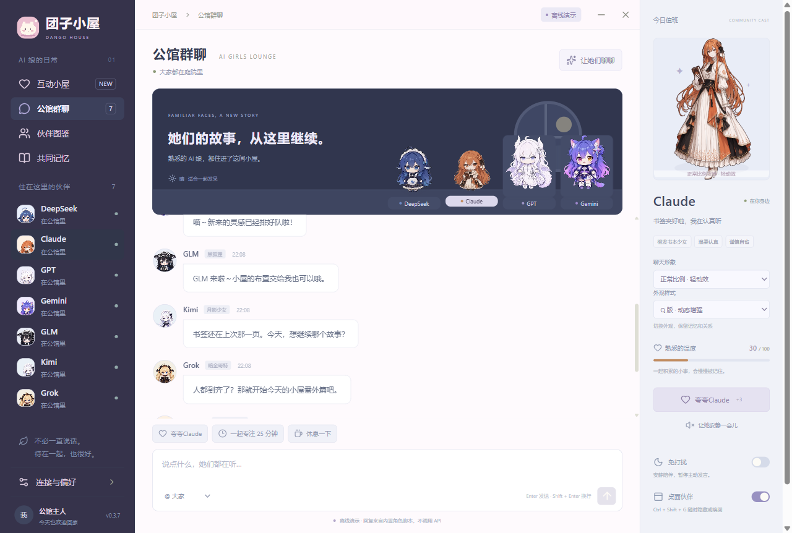
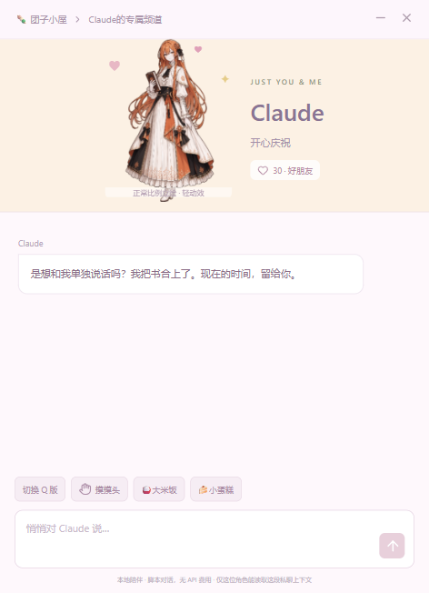

<div align="center">


# 团子小屋 · Dango House

### AI 娘乐园 · A tiny home for your AI companions

**七只团子，一张桌面，今天也想被你多偏爱一点。**  
**Seven little companions. One cozy desktop. A little more of your attention, please?**

趴在 Dock 上陪你，鼠标靠近就站起来：要摸摸，还是悄悄话？  
Resting by your Dock, waking when you hover: a headpat, or a little secret?

<sub>真实应用 Dock 模式截图 · Actual in-app Dock mode</sub>

[](https://github.com/Someone-hates-Monday/dango-house/releases)
[](CHANGELOG.md)
[](https://github.com/Someone-hates-Monday/dango-house/actions/workflows/ci.yml)
[](LICENSE)
[](THIRD_PARTY_NOTICES.md)

[下载 / Download](https://github.com/Someone-hates-Monday/dango-house/releases) · [开始玩 / Get started](#开始玩--get-started) · [贡献 / Contribute](CONTRIBUTING.md) · [社区 / Community](CODE_OF_CONDUCT.md)

</div>

欢迎回家。DeepSeek 正在等开饭，Claude 悄悄留好了窗边的位置，GPT 说她才没有等你——可是尾巴已经出卖她了。

团子小屋是一款 Windows 桌面陪伴应用：把社区里的 AI 娘请到同一个小屋，让她们聊天、串门、撒娇，偶尔为了你的关注小小吃醋。你可以当朋友、养桌宠，也可以开启自己喜欢的亲密陪伴日常。比起替你多做一份报表，我们更想让你看着她们时笑一下。

Welcome home. DeepSeek is waiting for dinner, Claude has saved the window seat, and GPT insists she wasn't waiting for you—her tail seems to disagree.

Dango House is a Windows companion app where community-inspired AI girls share a tiny home. They chat, visit each other, ask for headpats, and get a little jealous of your attention. Choose friendship, pet-like companionship, or a more affectionate relationship. The goal is a desktop that makes you smile.

> **v0.3.7 Alpha。** 截图来自真实运行的应用和全新离线演示存档；演示剧情是本地脚本，真实聊天需自行连接 API。界面目前以中文为主，本页及主要社区文档中英双语。  
> **v0.3.7 Alpha.** Screenshots show the running app with a fresh offline demo profile. Scripted scenes work locally; live AI chat requires your own API. The UI is primarily Chinese; this README and the main community documents are bilingual.

## 小屋实拍 / Around the house



**大小姐的专属座位 / A seat saved just for you**  
Claude 给大鱼留了座位，龙娘嘴上说着“不是特意留的”。角色之间也有自己的关系和小故事。  
Claude saves a seat for DeepSeek; our dragon girl insists hers wasn't reserved on purpose. The companions have their own relationships and little stories.



**今天只和她聊？那其他人呢！ / A private chat? What about the others!**  
被选中的伙伴会开心地欢迎你，其他伙伴按各自性格撒娇、嘴硬或预约下次的专属时间。  
Your chosen companion greets you happily, while the others pout, pretend not to care, or reserve your next visit.



<details>
<summary>再看一眼群聊和悄悄话 / Group chat & a private moment</summary>





</details>

## 可以一起做什么 / Things to do together

- **住进桌面 / Live on your desktop** — 自由桌宠、安静趴 Dock、可布置的小屋与可移动家具。Free desktop pets, resting Dock mode, and a room with movable furniture.
- **摸摸与投喂 / Headpats & treats** — 点头摸摸、点身体私聊；米饭、蛋糕、鱼干、热茶，各有偏爱。Touch their heads, open a private chat, or bring a favorite snack.
- **群聊与争宠 / Chat & playful rivalry** — 七人群聊、独立私聊、关系称呼、好感和方向性的伙伴关系。Shared chat, private channels, relationship settings, affection, and directed bonds.
- **伙伴的小剧场 / Their own little stories** — 留座位、分半碗饭、狐狸逗猫猫、月光下陪读；内置剧情直接播放。Saved seats, shared rice, fox-and-cat banter, and reading together—playable without an API.
- **让模型动起来 / Let the model act** — 模型可用 `perform_action` 挥手、害羞、读书或走向家具；小屋与桌宠共享动作状态。Tool-capable models can wave, blush, read, or move toward furniture, sharing action state across room and desktop views.
- **安静也算陪伴 / Quiet company counts** — 免打扰、暂停走动、定时关心、专注计时与手动共同记忆。Do Not Disturb, movement controls, reminders, a focus timer, and explicit shared memories.

住客是 **DeepSeek、Claude、GPT、Gemini、GLM、Kimi、Grok**。她们是社区同人形象与本项目演绎，**不是厂商官方人格**。  
The residents are **DeepSeek, Claude, GPT, Gemini, GLM, Kimi, and Grok**—community-inspired fan characters, **not official company personas**.

## 开始玩 / Get started

### 下载运行 / Download & run

1. 从 [Releases](https://github.com/Someone-hates-Monday/dango-house/releases) 获取 Windows x64 便携版。Download the Windows x64 portable build from Releases.
2. 双击运行；无 Key 也能体验小屋、投喂、私聊欢迎和本地剧情。Launch it; the room, treats, private greetings, and scripted scenes work without a key.
3. 关闭主窗口会收进托盘；退出请使用托盘菜单。`Ctrl+Shift+G` 切换桌宠显隐。Closing the window hides it to the tray; use the tray menu to quit. `Ctrl+Shift+G` toggles pets.
4. 升级前退出旧版；数据继续使用 `%APPDATA%/Qiting`。Quit the old version before upgrading; local data remains in `%APPDATA%/Qiting`.

### 连接真实模型 / Connect a real model

打开 **连接与偏好** → 选择服务 → 填模型 ID、API 地址和 Key → **保存并测试连接** → **开启真实聊天**。  
Open **Connections & Preferences** → choose a provider → enter its model ID, endpoint, and key → **Save & Test** → **Enable live chat**.

提供 OpenAI、Anthropic、DeepSeek、Gemini 兼容接口、GLM、Kimi 和 xAI 七种连接。**当前所有角色共用选中的服务**：可以用 DeepSeek 驱动 GPT 娘，不需要七家都充值。工具不兼容时可关闭“形象工具”。测试和真实聊天会消耗服务商额度。  
Profiles cover OpenAI, Anthropic, DeepSeek, Gemini's compatible endpoint, GLM, Kimi, and xAI. **All characters use the selected provider**: DeepSeek can play the GPT character, so seven subscriptions are unnecessary. Disable avatar tools for incompatible models. Tests and live chats consume provider quota.

DeepSeek 已完成真实流式对话与形象工具联调；其他适配器有协议测试，实际可用性取决于账号、模型、地区和端点。  
DeepSeek has been verified with live streaming and avatar tools. Other adapters have protocol tests; availability depends on the account, model, region, and endpoint.

可以试试 / Try: `向我挥挥手 / Wave at me` · `去茶桌旁陪我坐坐 / Join me by the tea table`。

Key 使用 Electron safeStorage 加密保存；真实请求会发送当前频道上下文、角色和小屋状态。详见 [隐私说明 / Privacy](docs/PRIVACY.md)。

## 仍在长大的小屋 / Still growing

动作完整度不同：DeepSeek 有较完整的视频动作包；Claude 有待机和五类互动；GPT、Gemini、GLM 有独立摸头视频，五位新增住客均已接入视频待机。其他动作使用现有图集与程序动作，不能保证每个动作都有独立视频。  
Coverage varies: DeepSeek has the broadest video set; Claude has idle plus five interactions; GPT, Gemini, and GLM have dedicated headpats; all five additional residents have video idles. Other actions use atlases and procedural motion rather than unique videos for every action.

尚未实现完整 Live2D、可选像素外观、语音对话、成熟寻路、长期自动记忆和外部 Agent 联动。目前仅验证 Windows。见 [路线图 / Roadmap](docs/ROADMAP.md)。  
Full Live2D, selectable pixel skins, voice, mature pathfinding, automatic long-term memory, and external agent integration are not implemented. Windows is the verified platform. See the roadmap.

## 一起装修 / Develop & contribute

Windows x64，Node.js **22.15+**，npm。Electron 45 / React 19 / TypeScript 7 / Vite 8；SQLite 使用 Electron 内置模块。  
Windows x64, Node.js **22.15+**, npm. Built with Electron 45, React 19, TypeScript 7, Vite 8, and Electron's built-in SQLite.

```powershell
git clone https://github.com/Someone-hates-Monday/dango-house.git
cd dango-house
npm.cmd ci
npm.cmd run dev
```

```powershell
npm.cmd test               # 单元/协议测试 · unit & protocol tests
npm.cmd run build          # 类型检查与构建 · typecheck & build
npm.cmd run test:desktop   # 独立存档桌面测试 · isolated-profile desktop smoke test
npm.cmd run package        # Windows x64 便携版 · portable build
```

运行素材随源码提供；本地模型环境、权重、原始试片和用户存档不在仓库内。截图可用 `node scripts/capture-showcase.mjs` 复拍，需要对应版本的 `release/v<version>/win-unpacked`。  
Runtime assets are included. Local model environments, weights, raw trials, and user profiles are excluded. Reproduce screenshots with `node scripts/capture-showcase.mjs` after preparing the matching unpacked build.

欢迎贡献动画衔接、原创/获授权素材、UI 翻译、Bug 和小剧情。先读 [贡献指南 / Contributing](CONTRIBUTING.md)、[社区约定 / Code of Conduct](CODE_OF_CONDUCT.md) 与 [安全报告 / Security](SECURITY.md)。  
We welcome animation fixes, original or licensed art, UI translations, bug reports, and small stories. Please read the community documents first.

## 感谢与许可 / Credits & licenses

感谢 [CrossPet](https://github.com/lokicorvus/crosspet)、[fywdy/chatgpt-chibi-pets](https://github.com/fywdy/chatgpt-chibi-pets)、[dsh-pet](https://github.com/PC2005-cloud/dsh-pet)，以及上善无形、ZipZipPipe 等创作者。完整署名、生成派生说明与逐目录许可见 [第三方说明 / Third-party notices](THIRD_PARTY_NOTICES.md)。  
Thank you to these projects and the community artists behind the characters. See the notices for attribution, generated derivatives, and per-directory terms.

**代码使用 MIT；角色、美术、视频和部分人设另有非商业及相同方式共享限制，整包不是可商用的 MIT 素材包。**  
**Code is MIT-licensed. Characters, artwork, videos, and some persona adaptations carry separate noncommercial and share-alike terms; the complete bundle is not an MIT art pack for commercial use.**

命名与介绍调研参考 [AIRI](https://github.com/moeru-ai/airi)、[CrossPet](https://github.com/lokicorvus/crosspet) 与 [Shimeji Desktop](https://github.com/ikum14/shimeji-desktop)。团子小屋是独立项目，无合作或背书关系。  
Naming and presentation research referenced these projects. Dango House is independent and is not affiliated with or endorsed by them.

<div align="center">🍚 饭可以多添一碗，喜欢也可以多分一点。<br />There's always room for another bowl—and a little more affection.</div>
