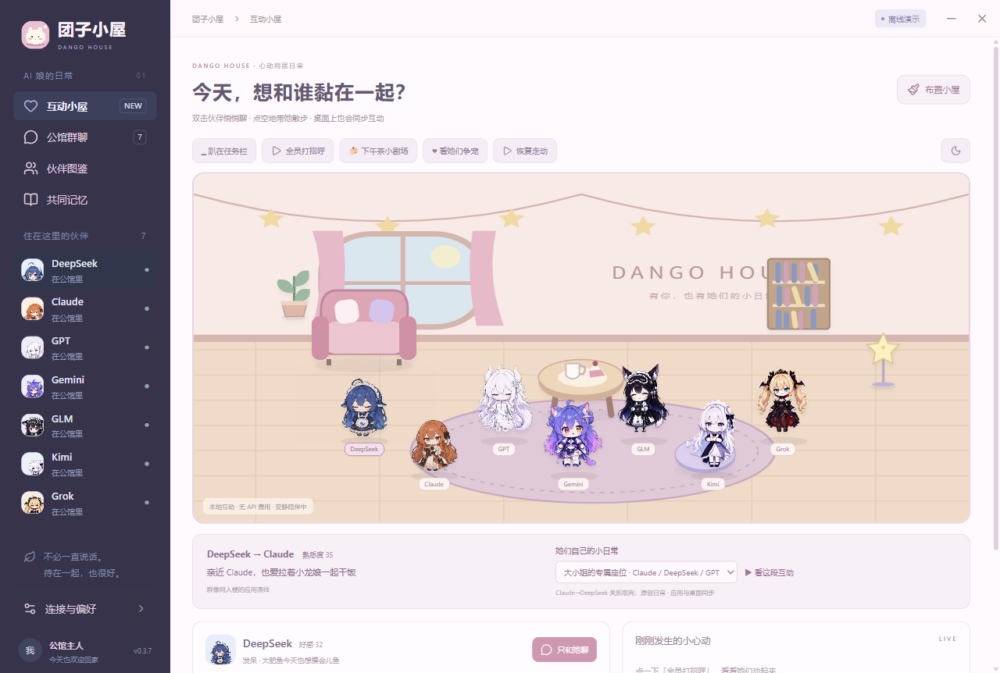
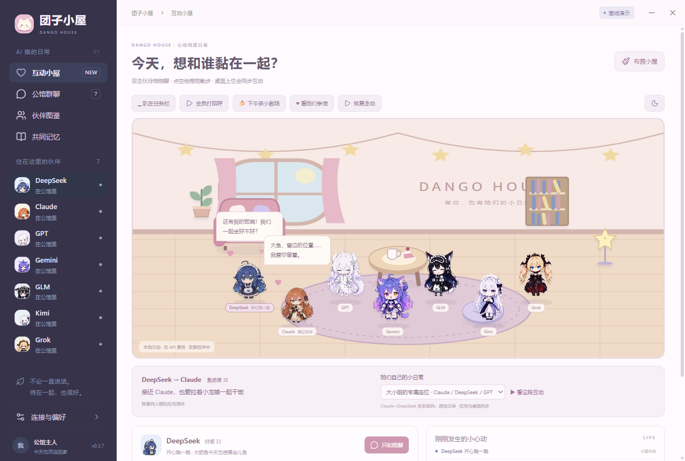
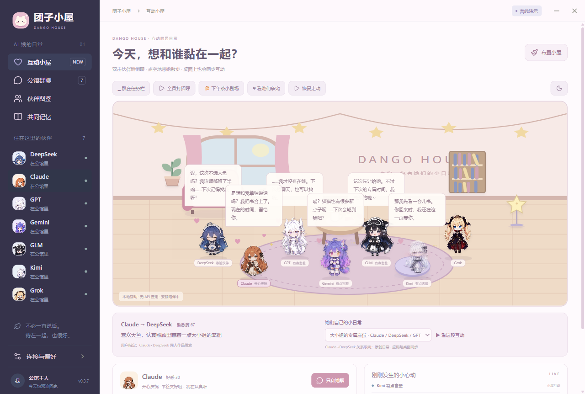
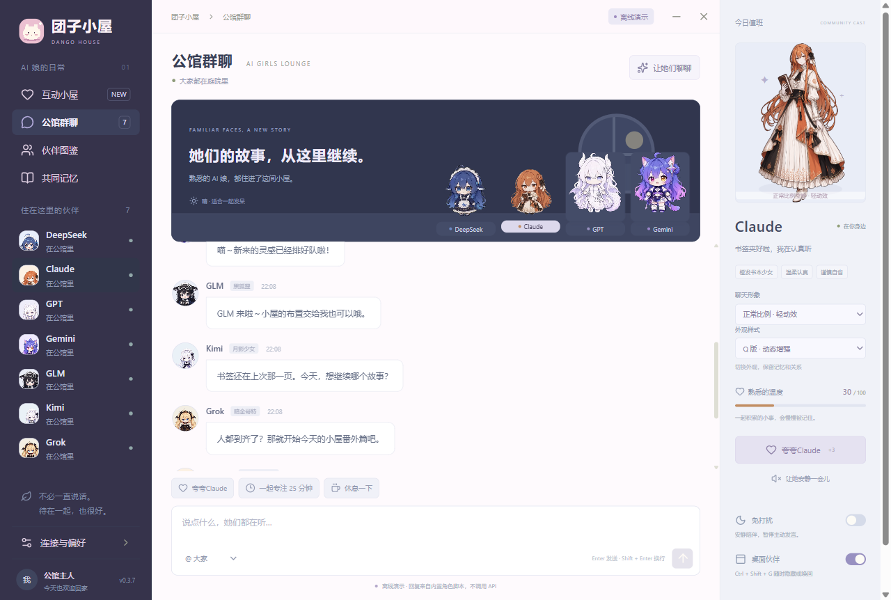
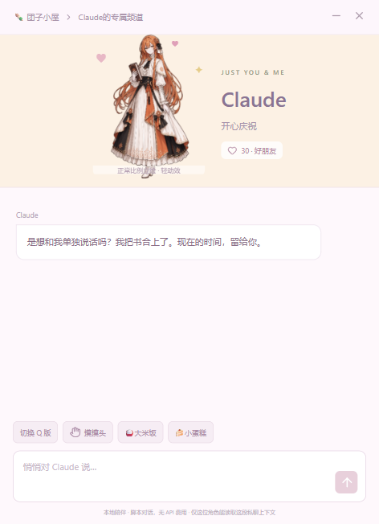

<div align="center">


# 团子小屋 · Dango House

### AI 娘乐园

**语言：** [简体中文](README.zh-CN.md) · [English](README.en.md) · [日本語](README.ja.md) · [索引](README.md)

**七只团子，一张桌面，今天也想被你多偏爱一点。**

趴在 Dock 上陪你，鼠标靠近就站起来：要摸摸，还是悄悄话？

<sub>真实应用 Dock 模式截图</sub>

[](https://github.com/Someone-hates-Monday/dango-house/releases)
[](CHANGELOG.md)
[](https://github.com/Someone-hates-Monday/dango-house/actions/workflows/ci.yml)
[](LICENSE)
[](THIRD_PARTY_NOTICES.md)

[下载](https://github.com/Someone-hates-Monday/dango-house/releases) · [开始玩](#开始玩) · [贡献](CONTRIBUTING.zh-CN.md) · [社区](CODE_OF_CONDUCT.zh-CN.md)

</div>

欢迎回家。DeepSeek 正在等开饭，Claude 悄悄留好了窗边的位置，GPT 说她才没有等你——可是尾巴已经出卖她了。

团子小屋是一款 Windows 桌面陪伴应用：把社区里的 AI 娘请到同一个小屋，让她们聊天、串门、撒娇，偶尔为了你的关注小小吃醋。你可以当朋友、养桌宠，也可以开启自己喜欢的亲密陪伴日常。比起替你多做一份报表，我们更想让你看着她们时笑一下。

> **源码 v0.3.9 Alpha；公开便携 Release 仍为 v0.3.7。** 截图来自隔离的离线存档，版本见截图说明；演示剧情是本地脚本，真实聊天需自行连接 API。应用内可切换 **简体中文 / English / 日本語**。

一把 API Key 就能演绎全员人设，也可给角色覆盖后端。DeepSeek 的 109 段动画已接入共享互动菜单；偏爱 streak、双人短剧及可选 MCP/REST 舞台桥均已接线。**今日在场目前只限制发言，不会隐藏休息角色**；持续共同记忆和更自然的社交闭环是下一阶段工作，不能当成七位完全自主 Agent。

[下一阶段规划与验收](docs/CURSOR-COMPANIONSHIP-NEXT.zh-CN.md) · [交给 Cursor 的任务提示词](docs/CURSOR-NEXT-PROMPT.md)

## 小屋实拍



**大小姐的专属座位**  
Claude 给大鱼留了座位，龙娘嘴上说着“不是特意留的”。角色之间也有自己的关系和小故事。



**今天只和她聊？那其他人呢！**  
被选中的伙伴会开心地欢迎你，其他伙伴按各自性格撒娇、嘴硬或预约下次的专属时间。



<details>
<summary>再看一眼群聊和悄悄话</summary>





</details>

## 可以一起做什么

- **住进桌面** — 自由桌宠、安静趴 Dock、可布置的小屋与可移动家具。
- **摸摸与投喂** — 点头摸摸、点身体私聊；米饭、蛋糕、鱼干、热茶，各有偏爱。
- **群聊与争宠** — 七人群聊、独立私聊、关系称呼、好感和方向性的伙伴关系。
- **伙伴的小剧场** — 留座位、分半碗饭、狐狸逗猫猫、月光下陪读；内置剧情直接播放。
- **让模型动起来** — 模型可用 `perform_action` 挥手、害羞、读书或走向家具。
- **一起看短视频（开发中）** — 导入本地短视频，生成诚实覆盖标注的证据，由两三位伙伴讨论。
- **安静也算陪伴** — 免打扰、暂停走动、定时关心、专注计时与手动共同记忆。

住客是 **DeepSeek、Claude、GPT、Gemini、GLM、Kimi、Grok**。她们是社区同人形象与本项目演绎，**不是厂商官方人格**。

## 开始玩

### 下载运行

1. 从 [Releases](https://github.com/Someone-hates-Monday/dango-house/releases) 获取 Windows x64 便携版。
2. 双击运行；无 Key 也能体验小屋、投喂、私聊欢迎和本地剧情。
3. 关闭主窗口会收进托盘；退出请使用托盘菜单。`Ctrl+Shift+G` 切换桌宠显隐。
4. 升级前退出旧版；数据继续使用 `%APPDATA%/Qiting`。

### 连接真实模型

打开 **连接与偏好** → 选择服务 → 填模型 ID、API 地址和 Key → **保存并测试连接** → **开启真实聊天**。同一页可切换界面语言。

当前所有角色共用选中的服务。Key 使用 Electron safeStorage 加密保存。详见 [隐私说明](docs/PRIVACY.zh-CN.md)。

## 仍在长大的小屋

动作完整度不同；完整 Live2D、语音、成熟寻路等尚未实现。见 [路线图](docs/ROADMAP.zh-CN.md)。

共同观影 / Agent：已有本地导入与任务托盘；浏览找片与视觉理解未完成。见 [功能方案](docs/AGENT-WATCH-PARTY-PLAN.md) 与 [P0/P1 交接](docs/HANDOFF-AGENT-P0P1.md)。

## 一起装修

```powershell
git clone https://github.com/Someone-hates-Monday/dango-house.git
cd dango-house
npm.cmd ci
npm.cmd run dev
```

```powershell
npm.cmd test
npm.cmd run build
npm.cmd run test:desktop
npm.cmd run package
```

请先阅读 [贡献指南](CONTRIBUTING.zh-CN.md)、[社区约定](CODE_OF_CONDUCT.zh-CN.md) 与 [安全报告](SECURITY.md)。

## 感谢与许可

感谢 CrossPet、fywdy、dsh-pet，以及上善无形、ZipZipPipe 等创作者。详见 [第三方说明](THIRD_PARTY_NOTICES.md)。

**代码使用 MIT；角色、美术、视频和部分人设另有非商业限制，整包不是可商用的 MIT 素材包。**

<div align="center">🍚 饭可以多添一碗，喜欢也可以多分一点。</div>
