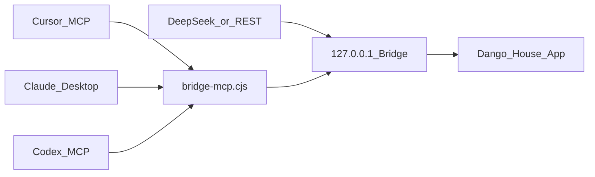

**Language:** [简体中文](AGENT-BRIDGE.zh-CN.md) · [English](AGENT-BRIDGE.en.md) · [日本語](AGENT-BRIDGE.ja.md) · [Index](AGENT-BRIDGE.md)

# Agent 插件桥：App 本体 + 可选插件

团子小屋 **仍然是独立桌面应用**。可选开启本机 Agent Bridge 后，Cursor / Claude Desktop / Codex / 其他 harness 可以把小屋当成「有人格的舞台/身体」调用，而不是把产品改成纯插件。

## 形态

| 形态 | 谁负责 | 说明 |
| --- | --- | --- |
| **App（默认）** | 用户直接打开团子小屋 | 陪伴、争宠、观影、桌宠完整可用 |
| **插件（可选）** | 外部 Agent 经 MCP/REST 调用 | 需 **小屋正在运行** 且设置里开启桥接 |



## 开启步骤

1. 打开团子小屋 → **设置** → **Agent 插件桥** → 启用。
2. 点击「复制 Cursor / Claude / Codex / DeepSeek 配置」。
3. 粘贴到对应客户端的 MCP / harness 配置。
4. **保持小屋运行**；插件进程只做中转。

安全：仅监听 `127.0.0.1`，Bearer token 存放在 `%APPDATA%/Qiting/bridge.json`，不广播 API Key。

## 各家适配

### Cursor

合并设置里复制的 JSON 到 Cursor MCP 配置（用户级 `mcp.json` 或项目 `.cursor/mcp.json`）。示例见 [`plugins/cursor.mcp.json.example`](../plugins/cursor.mcp.json.example)。

### Claude Desktop

合并到 Claude Desktop 的 `claude_desktop_config.json` 的 `mcpServers`。示例见 [`plugins/claude-desktop.json.example`](../plugins/claude-desktop.json.example)。

### Codex

合并到 Codex 的 MCP 配置（常见为 `~/.codex/config.toml` 的 `[mcp_servers.*]`）。示例见 [`plugins/codex.mcp.toml.example`](../plugins/codex.mcp.toml.example)。

### DeepSeek harness / 通用 REST

不强制 MCP：对运行中的桥发 HTTP：

- `GET /health`
- `GET /v1/snapshot`（需 `Authorization: Bearer <token>`）
- `GET /v1/tools`
- `POST /v1/call` body: `{ "name": "garden_praise", "arguments": { "id": "xia" } }`

示例见 [`plugins/deepseek-rest.json.example`](../plugins/deepseek-rest.json.example)。

## 暴露的工具（舞台能力）

`garden_get_snapshot` · `garden_list_characters` · `garden_say_as_user` · `garden_perform` · `garden_praise` · `garden_pat` · `garden_feed` · `garden_play_scene` · `garden_browse_videos` · `garden_agent_control`

**不会**暴露：本机 API Key、任意文件系统、通用终端。外部 Agent 仍是「大脑」，小屋是「身体与社交层」。

## 开发构建

```powershell
npm.cmd run build
# 产出 dist-electron/bridge-mcp.cjs
```

## 交接

实现状态、已测/未测、人手验收清单与「下一步」见 **[HANDOFF-COMPANION-BRIDGE.zh-CN.md](HANDOFF-COMPANION-BRIDGE.zh-CN.md)**。
