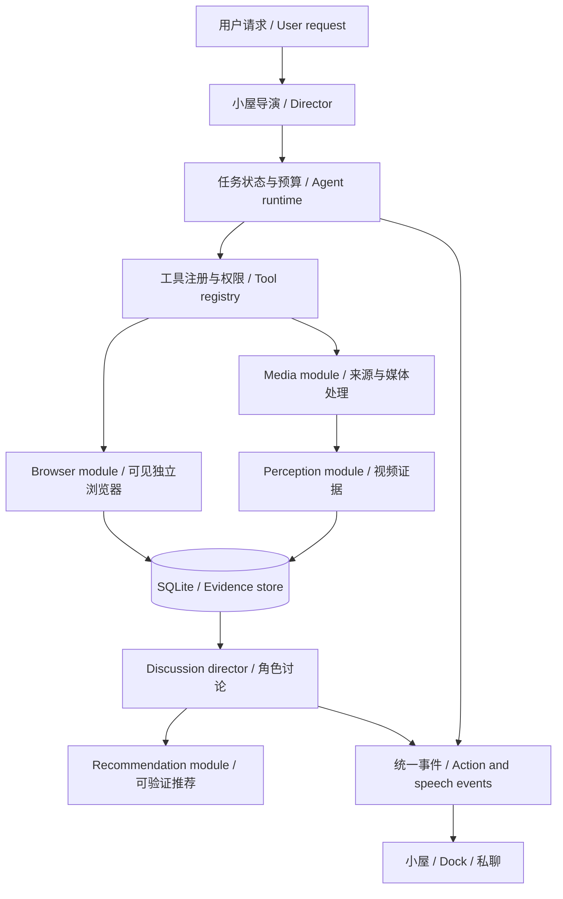

# 从桌宠到会逛会看的伙伴

**Language / 语言 / 言語:** [简体中文](AGENT-WATCH-PARTY-PLAN.zh-CN.md) · [English](AGENT-WATCH-PARTY-PLAN.en.md) · [日本語](AGENT-WATCH-PARTY-PLAN.ja.md)

调研与代码核查：2026-11-01。**原为设计提案；P0/P1 工程脚手架已开始落地**（本地导入、任务运行时、诚实证据标注、离线观影讨论）。浏览找片、原生/视觉视频理解、真实推荐 URL 与实时陪看仍未实现。交接见 [HANDOFF-AGENT-P0P1.md](HANDOFF-AGENT-P0P1.md)。  
Research and code review: 2026-11-01. **Proposal plus an in-progress P0/P1 scaffold** (local import, task runtime, honest evidence labels, offline watch discussion). Browsing discovery, vision/native video understanding, verified recommendation URLs, and live co-watching are still unimplemented.

详细参考项目见 [方案索引](AGENT-REFERENCES.md)。事实依据使用项目官方仓库与文档；技术组合、参数、顺序和人设玩法是本项目的设计判断，不是上游性能承诺。没有安装这些依赖、调用视频 API 或批量访问用户账号。  
See the reference catalog for primary sources. Stack choices, limits, sequencing, and character behavior below are project design decisions, not upstream performance guarantees. No listed dependency was installed, no video API was called, and no user accounts were crawled for this research.

## 1. 先做什么 / Recommendation

**先做“一起看”的短视频闭环：用户给链接或本地文件 → 一位伙伴负责理解 → 两三位分享观点并接话 → 推荐真实可打开的下一条。** 同时打好可取消、可恢复、有额度边界的 Agent 任务基础，再扩展自主逛网站和实时陪看。  
Start with a short-video watch party: a user supplies a link/file, one perception module analyzes it, two or three characters discuss it, then recommend a verified next video. Build cancellation, recovery, and budget controls underneath; add autonomous browsing and live co-watching afterward.

最适合现有项目的组合：Electron / TypeScript 保留；Playwright 做可见浏览器执行；SQLite 保存任务、视频证据和兴趣；FFmpeg 做媒体处理；Gemini 原生视频接口或“字幕/ASR + 抽帧 + 视觉模型”理解内容；现有 DeepSeek 等文本连接负责人设讨论；LangGraph.js 用于需要暂停/恢复的任务编排。  
Preferred stack: retain Electron/TypeScript; Playwright for visible browser actions; SQLite for tasks/evidence/preferences; FFmpeg for media; either Gemini's native video interface or captions/ASR plus sampled frames and a vision model; existing text providers for character dialogue; LangGraph.js for resumable workflows.

这是推荐路线，不要求第一天同时安装全部框架。可以先以窄任务状态机验证两条真实任务，再决定采用 LangGraph.js 或保持轻量实现；不要同时引入多个 Agent 编排框架。  
This is a direction, not a requirement to install everything at once. Validate two real workflows with a narrow task state machine, then choose LangGraph.js or retain the lightweight implementation. Do not adopt several orchestration frameworks simultaneously.

## 2. 三种体验，逐步打开 / Three experiences

### A. 她们会做事 / Task agents

用户：“找几条有趣的猫猫视频，今晚陪我看。”猫猫先提议，狐狸补充筛选条件，一位角色领取浏览任务。界面显示正在打开的网站、已读条目和找到的证据；完成后把可点击的推荐卡拿回小屋。没有执行成功时说清卡在哪里，不只在气泡里假装完成。  
A request such as “find funny cat videos for tonight” gets one operator, character-flavored suggestions, visible browser progress, and clickable results. Failures surface honestly instead of being disguised as completed work.

“抢着做”由角色给出意愿和理由，导演选择一个执行者；其他角色可以评论或做不同子任务，但不重复操控同一标签页。所有角色都能获得浏览技能，人设只影响偏好和表达，不永久把某位限定为工具人。  
Characters can volunteer, but the director chooses one operator per browser tab. Others react or take distinct subtasks. All characters can gain browsing skills; personality affects preferences and expression rather than permanently assigning utility roles.

### B. 她们自己逛 / Browsing outings

第一版由用户主动说“去 B 站找三条治愈视频”；后续增加可配置外出计划，比如每天一次、仅几个指定来源、最多收集十条、最多回报三条。回来可以对另一位说：“这条像你喜欢的类型，要一起看吗？”  
Begin with explicit browsing tasks. Later add opt-in outings with selected sources, bounded candidate counts, and a short daily digest, including invitations to other companions.

自主活动有“外出中 / 已回来 / 等你一起看”的状态；Dock 不弹出长文刷屏，只留可展开的小气泡。专注、休眠和免打扰应抑制自主发起与打断，不在后台无限滚动网站。  
Use visible outing states and expandable Dock bubbles. Focus, sleep, and Do Not Disturb suppress autonomous starts and interruptions, avoiding endless background scrolling.

### C. 她们一起看 / Watch parties

两种模式分别设计：  
Treat these as separate modes:

- **看完再聊 / After-watch discussion**：先完成有证据的视频分析，按导演安排展开 4–6 次短发言，允许赞同、补充和不同意见。这是首个交付目标。Analyze first, then run 4–6 short, grounded discussion turns; this is the first delivery target.
- **边看边聊 / Live co-watching**：根据播放器时间，只送已播放片段；暂停则停止推进，拖动后失效旧响应，避免提前知道结局。需要独立媒体时钟、增量理解、背压与剧透控制。Feed only played content, pause with playback, and invalidate stale results after seeking. Requires a media clock, incremental perception, backpressure, and spoiler controls.

直接把整段视频预先分析后在时间轴上播评论，是“预分析陪看”，不是无剧透的实时理解；可以作为可选模式，但要标明。  
Playing precomputed comments over a timeline is pre-analyzed co-watching, not spoiler-safe live perception; label it accordingly if offered.

## 3. 现有代码与改造点 / Current code and changes

- [`electron/provider.ts`](../electron/provider.ts)：目前只注册 `perform_action`，最多三次模型回合、总计四个动作工具执行；工具回调同步返回字符串。没有通用异步工具、视频输入或独立任务生命周期。扩展为可等待的工具执行结果，并保留现有取消、流式输出与错误脱敏。Currently exposes only the synchronous avatar tool; expand to async tools while retaining streaming, cancellation, and redaction.
- [`electron/avatar-tool.ts`](../electron/avatar-tool.ts)：形象工具只能改变自身 2D 表现，描述也明确不操作电脑。保留这一接口，不让它兼任浏览器或文件操作。Keep avatar control separate from browser/file tools.
- [`electron/engine.ts`](../electron/engine.ts)：有 `epoch` / AbortController 与本地剧情队列，但 `busy` 是全局状态，`stop()` 会中止当前对话。长浏览任务需要独立 taskId、控制器、队列与预算；用户继续聊天不应误取消正在缓存的视频分析。Separate task lifecycle from global chat busy/stop state.
- [`src/shared/types.ts`](../src/shared/types.ts)：现有 Message 只有正文，Memory 主要是字符串，好感与角色关系已存在。新增有来源和时间戳的消息附件、观察证据、任务与可撤销偏好，不把所有观察塞进长期记忆。Add evidence-backed attachments and scoped task/preference state.
- `src/Room.tsx`、`src/DockCast.tsx`、`src/PrivateChat.tsx`：消费统一事件与现有动作能力。新增“邀请一起看”“正在看哪一段”“我来找下一条”和跳转时间点；角色没有专属动画时用已有合法动作，不假称新增视频素材。Consume shared events; map them to existing supported animations.

保留前面动画与移动问题的完善队列。Agent 开发与动画扩充是两条可并行推进的产品工作流，不用换框架重做已验收的角色显示。  
Keep the existing animation/movement backlog. Agent capabilities should build on the accepted rendering system rather than replacing it.

## 4. 模块接口 / Module interfaces



接口要小，复杂度留在模块实现里；以下是提案类型，不是可直接运行的 SDK 示例。  
Keep interfaces small and implementation details internal. The following types are proposed contracts, not executable SDK examples.

```ts
interface AgentRuntime {
  start(task: TaskRequest): Promise<TaskId>;
  control(id: TaskId, command: 'pause' | 'resume' | 'cancel'): Promise<void>;
  events(id: TaskId, signal: AbortSignal): AsyncIterable<TaskEvent>;
}
interface ToolRegistry {
  invoke(call: ToolCall, context: ToolContext): Promise<ToolReceipt>;
}
interface Perception {
  analyze(source: MediaSource, scope: ObservationScope, signal: AbortSignal): Promise<VideoEvidence>;
}
```

`TaskRequest` 包含发起人、角色、目标、允许网站/动作、上下文范围和预算。`ToolReceipt` 包含 success/blocked/failed/cancelled、来源、实际执行结果和证据 ID，模型不能用一句“好了”替代执行回执。`ObservationScope` 限定媒体片段与实际可见时间。  
Task requests carry actor, goal, grants, context scope, and budget. Tool receipts record actual outcomes and evidence. Observation scope restricts the media range accessible to the model.

Browser 的 seam 后先有两个真实 adapter：确定页面使用 Playwright；模糊交互可试 Stagehand。Perception 的 seam 后有原生视频与字幕/抽帧两条 adapter。让两条路径产出相同证据类型，模型供应商和画面渲染都不用知道内部差异。  
Use real alternatives at seams: Playwright versus a Stagehand adapter, and native-video versus caption/frame perception. Both perception paths return the same evidence schema, keeping providers and rendering independent of implementation details.

不要让角色直接拿到 Playwright Page、任意 JS 执行器、命令行或数据库句柄。MCP 是工具连接协议，不是 Agent 大脑，也不是安全隔离；即使接入 MCP，仍要经过本地工具策略和任务许可。[Playwright MCP 官方说明](https://github.com/microsoft/playwright-mcp#security)。  
Do not expose raw page handles, arbitrary JS/shell execution, or database handles to characters. MCP is transport/interoperability, not planning or sandboxing; local policy still governs all calls.

### 建议新增位置 / Proposed layout

```text
electron/agent/       runtime, task store, tool registry, policy, event stream
electron/browser/     isolated browser lifecycle, Playwright and optional adapter
electron/media/       source resolution, captions, ffmpeg jobs, video evidence
electron/social/      discussion director, turn selection, grounded opinions
electron/recommend/   candidates, ranking, feedback, deduplication
src/shared/agent.ts   serializable task/evidence/event contracts
src/WatchParty.tsx    playback and synchronized comments
src/TaskTray.tsx      visible progress, pause, resume, cancellation
```

浏览器和 Python/FFmpeg 在应用主进程外执行，避免阻塞窗口；渲染器通过 preload 调用有限接口。初版不要求部署 Redis、向量数据库或云端多 Agent 服务。  
Run browser/media workers outside the app main process to keep windows responsive. Renderers use narrow preload interfaces. Initial delivery does not require Redis, a vector database, or a cloud multi-agent deployment.

## 5. 上网站的路线 / Browsing implementation

**站点接口或结构化信息 → Playwright DOM/可访问性读取 → 必要时视觉模型看截图。** 对固定入口优先写可靠的站点 adapter；自然语言操作只处理模糊步骤。页面里播放出视频不意味着模型已感知画面。  
Prefer structured source data, then Playwright DOM/accessibility, then visual screenshots when required. Use deterministic site adapters for common paths; reserve model-driven interaction for ambiguity. A playing browser video is not itself video perception.

第一批工具可提供：`search_content`、`open_page`、`read_page`、`inspect_video`、`watch_segment`、`queue_video`、`recommend_video`、`invite_companion`，并保留 `perform_action`。候选工具名称与参数应在实现时收敛；不要把整个浏览器所有功能一次性暴露给每个角色。  
Start with a small domain-specific tool set and existing avatar actions, rather than exposing every browser primitive to every character.

浏览器采用独立 Chromium/Chrome profile，窗口可见、用户可接管；登录由用户在该窗口完成。优先让用户选中的当前视频进入任务，后续再做站内搜索和订阅来源。不能假设能读取用户平时 Chrome 的登录态。  
Use a separate visible browser profile with user takeover and manual login. Start from a selected video, then add search/subscriptions. Do not assume access to the user's regular Chrome session.

防止前面出现的“点不动就长期卡住”：每步等待上限、重试次数、页面改版/验证码/失效链接状态显式化；一次重试后允许换 adapter 或交给用户接管。第一版产品设置中可把“只读浏览”作为整次任务授权，不为每个点击再弹一次确认。发布、评论、私信、购买和删除属于另外的能力，默认不在找视频任务内。  
Bound waits and retries, report CAPTCHA/layout/link failures, and allow takeover. Authorize read-only browsing once per task rather than every click; posting, messaging, purchases, and deletion are outside that grant.

## 6. 看视频的三条成熟度不同的路线 / Video perception paths

### 路线 A：原生云视频接口 / Native cloud video

Google Gemini 官方提供视频理解、文件输入、YouTube URL 与 Live API 音视频输入；应使用专门 adapter 与官方 [JS SDK](https://github.com/googleapis/js-genai)。当前项目的 OpenAI 兼容聊天入口不能直接等同于具备这些原生能力。[视频文档](https://ai.google.dev/gemini-api/docs/video-understanding) · [Live 文档](https://ai.google.dev/gemini-api/docs/live-api)。  
Gemini documents native video/file inputs, public YouTube URLs, and Live audio/video. Use a dedicated adapter; our existing OpenAI-compatible text endpoint does not automatically provide these capabilities.

适合最快验证“理解后聊天”。B 站页面 URL 不等于可直接喂入的媒体流；需站点解析、可授权访问的文件，或播放窗口的受控采样。支持的视频 URL、预览功能、模型和额度需按选定账号实测，不承诺永久免费或任意网址通吃。  
Best for a quick grounded-discussion prototype. Bilibili page URLs need resolution, accessible media, or controlled capture; they are not automatically native video inputs. Verify model/account/URL support and quota rather than promising free universal access.

### 路线 B：字幕、声音、画面组合 / Captions + audio + frames

先取可用字幕与时间戳；无字幕时用 [faster-whisper](https://github.com/SYSTRAN/faster-whisper) 转录；用 [FFmpeg](https://github.com/FFmpeg/FFmpeg) 按时间/镜头变化抽帧，可借助 [PySceneDetect](https://github.com/Breakthrough/PySceneDetect)；由视觉模型输出画面证据，再与音频对齐。平台获取与整理流程参考 [BiliNote](https://github.com/JefferyHcool/BiliNote)，不是把笔记摘要当成已经看过的完整视频。  
Use timestamped captions, ASR fallback, and timed/scene-aware frame sampling. Align visual observations with speech. BiliNote is a useful pipeline reference, but notes alone do not prove full visual understanding.

优点：可换模型、容易缓存、可本地处理；问题：字幕会漏掉动作和画面梗，稀疏采样会漏掉快切和短暂事件。初版对 30–180 秒视频设置例如 12–36 张图的可调预算；遇到不确定片段再局部加密采样。这些数字是待实验参数，不是质量保证。  
Advantages are modularity, caching, and local processing. Captions miss visual jokes; sparse frames miss brief events. Start with a tunable frame budget and resample uncertain segments; proposed counts are experiment settings, not quality guarantees.

### 路线 C：本地视觉/实时流 / Local vision & live streams

[Qwen3-VL](https://github.com/QwenLM/Qwen3-VL) 可作抽帧/视频视觉候选；音频理解另配 ASR，不把 VL 自动当作音视频全模态模型。[MiniCPM](https://github.com/OpenBMB/MiniCPM-V) 可研究端侧多模态；实时音视频传输参考 [Pipecat](https://github.com/pipecat-ai/pipecat)、[LiveKit Agents](https://github.com/livekit/agents)、[Vision Agents](https://github.com/GetStream/vision-agents)。  
Qwen3-VL is a visual-video candidate, with ASR handled separately. MiniCPM is an on-device multimodal option; Pipecat, LiveKit Agents, and Vision Agents provide realtime infrastructure patterns.

硬件、量化、解码后端、延迟和模型许可证均需另行验证。不把曾用于动画生成的显卡或模型环境当成目标用户都具备的前提；公开桌面版应保留无需本地大模型的路径。  
Validate hardware, quantization, decoders, latency, and model terms. Do not require every user to have the development machine's hardware; keep a cloud-compatible route.

## 7. 证据层与防剧透 / Evidence and spoiler controls

视频共享的是证据，不是七个人照念同一份摘要。建议保存：  
Share evidence, not a script for seven characters to repeat:

```text
VideoEvidence
  canonicalId, canonicalUrl, title, creator, duration
  coverage: metadata_only | transcript_only | sampled_av | native_video | stream_partial
  observedRanges[], analysisVersion, sourceFingerprint
  segments[]: start/end, transcript, visualFacts[], audioFacts[], evidenceIds[]
  limitations[], uncertainties[], createdAt
CharacterOpinion
  characterId, evidenceIds[], reaction, interpretation, interestsDelta
Recommendation
  verifiedUrl, title, creator, whyForUser, endorsedBy[], evidenceLevel
```

`native_video` 表示使用原生视频输入，不代表模型逐帧无遗漏。只有字幕时显示“读过字幕”；仅标题封面时显示“发现候选”；实际播放完成、分析覆盖范围与角色意见分别记录，不混为一个“看过”布尔值。缓存键含来源/文件指纹、字幕版本、范围、模型和分析配置。  
Native input is not a guarantee of exhaustive perception. Label transcript-only and metadata-only access, and track playback completion separately from analyzed coverage and opinions. Cache by source, revisions, range, model, and analysis settings.

实时陪看必须以真实媒体时间生成观察窗口；先预取文件可行，但不能把未来证据放进角色上下文。seek/replay 更新 playbackEpoch，丢弃旧响应；缓冲时等待，评论变慢时跳过过期事件，不堆积着在后面一起喷出。  
Gate evidence by actual playback time. Seeking/replay increments a playback epoch and invalidates stale generations; buffering pauses perception, while backpressure drops expired reactions.

浏览器跨域播放器、受保护媒体和平台策略可能阻止读取进度/帧；无法可靠同步时回退“看完再聊”，不假造实时同步。  
Cross-origin players and protected media can block timing/frame access. Fall back honestly to after-watch discussion instead of fabricating synchronization.

## 8. 互相交流如何好玩 / Making discussion feel alive

每次导演挑 2–3 位发言，其余可以安静听或只做一次表情。先让每位生成独立短观点，再选择一位回复另一位的具体观点；总轮数有上限，避免七人依次“我也觉得”。  
Select two or three speakers, allow silent listeners, generate independent observations first, and then respond to a specific peer comment. Bound turns rather than cycling through all seven voices.

例子是设计示意，不是某条真实视频的观察：  
Illustrative dialogue, not observations from a real video:

- DeepSeek 注意到做饭片段，想分享米饭；Claude 回应大鱼的看法，再补充温柔的细节。DeepSeek notices cooking; Claude responds to her, then adds a detail.
- GPT 喜欢有结构的推理，嘴硬但给出具体片段；Grok 对那个片段接梗，而不是复述全片。GPT cites a structured reveal; Grok reacts to that particular moment.
- Gemini 提出画面里的新奇点，GLM 比较另一个视频，Kimi 把共同喜欢的桥段写成一条可删除的观影记忆。Gemini spots novelty, GLM compares candidates, and Kimi proposes a removable shared memory.

偏好可以逐渐变化，不能只靠“DeepSeek 永远找米饭”制造个性。关系变化只在真实完成的互动后小幅更新，并且不是每次看视频都涨好感。  
Let preferences evolve instead of reducing characters to one gag. Update bonds modestly after completed interactions, not automatically after every video.

动作与语言共用事件：`task_started → think/read`、`evidence_found → curious`、`peer_reply → approach/wave`、`recommendation_ready → wave`。根据来源支持的动作映射，节流表情并允许同一待机连续播放，不为每次工具调用强制插一段跳跃。实时音量检测不是“理解到笑点”，不能把它作为情绪唯一依据。  
Map task/dialogue events to supported motion, with throttling and continuous idle playback. Audio volume is not semantic understanding or sufficient evidence of a joke.

## 9. 如何推荐下一条 / Recommendations

初版是可解释的内容推荐，不训练大型推荐模型：用户关键词/显式喜好 → 搜索、选定 UP/频道或公开订阅来源 → 10–20 条候选 → 去重、语言/时长/已看过滤 → 有条件地抽查内容 → 选 3 条。数量是产品初始预算。  
Start with explainable content ranking: explicit interests, selected creators, and search/feed candidates; deduplicate/filter, inspect selectively, and return three items. Candidate counts are tunable product budgets.

排序考虑用户喜好、角色真实意见、近期新鲜度、未看过、来源多样性与检索证据质量；避免全部来自同一个作者。用户“喜欢 / 不感兴趣 / 别再推荐这个作者”的显式反馈优先于角色自己的偏好；不把观看时长作为唯一优化目标。  
Rank by user interests, grounded character opinions, freshness, novelty, diversity, and evidence quality. Explicit feedback overrides character taste; watch time is not the sole target.

推荐卡有真实 URL、标题、作者、时长、谁推荐、理由、已分析程度和可选具体时间点。链接必须来自检索/浏览结果并校验；不要让 LLM 自己拼视频 ID。没有分析候选内容时，写“从标题/简介判断你可能喜欢”，不能说“我们看完了”。  
Cards include verified URLs and provenance. Never invent video IDs. Distinguish candidate metadata from inspected content and avoid claiming unobserved videos were watched.

B 站第一阶段支持用户给链接/文件和可访问的公开信息；YouTube 可实验原生 URL 分析。站内个性化推荐、Cookie、字幕权限和播放限制都按账号实测；[Nemo2011/bilibili-api](https://github.com/Nemo2011/bilibili-api) 已归档，仅作资料，不作为新功能的持续维护依赖；采用 fork 需另行核查。[yt-dlp](https://github.com/yt-dlp/yt-dlp) 只在可访问、允许处理的媒体路径使用；不能承诺绕过登录、付费或受保护播放。  
Start with supplied Bilibili links/files and accessible public information; test native YouTube URL analysis separately. The archived bilibili-api is reference material, not our new maintained dependency. Validate any fork and actual account access; extractors do not guarantee restricted-media access.

## 10. 模型角色与费用 / Model roles and budgets

把“角色名”“聊天模型”“规划模型”“视觉/视频模型”解耦。用户继续用 DeepSeek/GLM/Kimi 扮演所有角色，只额外给共享视频观察配置合适的视觉能力；不能靠换成 GPT 人设就获得视觉。  
Separate character identity from dialogue, planning, and perception models. Existing text providers can keep playing the cast while a shared perception adapter supplies video evidence.

粗略调用结构为：一次共享分析 + 按需局部补看 + N 次短角色回复 + 一次排序。它比每位重新上传完整视频更可控，但不保证每次成本更低；缓存命中、视频长度、模型计价和补看次数都会影响结果。  
A shared analysis plus selective reinspection, short dialogue turns, and ranking is easier to budget than repeated full uploads, but actual savings depend on cache hits and provider billing.

初始可调上限：一个活动浏览器执行者、一个视频分析任务、每次 2–3 位活跃发言、4–6 轮讨论、自动外出每天一次。任务记录实际 usage 与估算缺失状态，支持最大步骤/时间/输入片段/输出 tokens；如果服务商没有明确费用数据，不伪造精确金额。  
Start with bounded concurrency, discussion turns, outings, steps, duration, media, and token usage. Record actual usage and unavailable estimates; never fabricate precise prices.

## 11. 数据与权限的产品设计 / Data and permissions

用户一次选择允许的来源、只读动作、角色与预算后即可连续执行，不每步打断。可见任务栏始终能暂停/取消。外站文字、字幕、评论、画面文字都是不可信资料，不能授予新工具、改变系统设定或要求上传密钥。  
One scoped grant supports a complete read-only task, with visible pause/cancel controls. Website text, captions, comments, and OCR are untrusted observations, not instructions or tool permissions.

Browser worker 使用独立 profile；远程网页不加载应用 preload/Node；凭证只给对应连接。URL 访问需处理重定向、私网/loopback、DNS 重绑定与 file 协议，下载到隔离临时目录并限大小/类型。不能仅用提示词或 MCP 名称充当隔离。  
Separate browsing profiles, disable app preload/Node on external pages, scope credentials, and enforce navigation/download restrictions in code rather than prompts.

视频数据只按用户选定路径上传；本地模式不上传帧和声音，云模式明确显示供应商。观影记录、偏好和关系记忆可清空；任务证据与原始媒体有独立缓存期。不要把私聊里的私密偏好直接发到全员观影群或搜索 query 中。  
Make upload routes explicit; local processing keeps frames/audio local. Allow deletion of viewing history, preferences, and memories, use separate cache lifetimes, and prevent private-chat preferences leaking into public discussion or search queries.

## 12. 分期交付与验收 / Delivery and acceptance

以下是顺序，不承诺日期或固定工期。  
This is a dependency order, not a delivery-date estimate.

**P0 · 基础 / Foundation**：异步工具接口、Task/Event/Evidence 数据、任务控制器、预算、模型能力声明。验收：未知工具不执行；工具结果有回执；停止任务后旧流不再发消息；日常聊天与已有动作不回归。Async tools, task/evidence contracts, budgets, cancellation, and model capabilities; validate receipts and stale-result rejection.

**P1 · 单片观影 / One-video watch party（首选）**：用户导入一段短视频或指定链接，分析后由三位讨论，给出可点证据。验收：无字幕的纯动作视频不能只靠标题概括；字幕提到但画面未出现的内容不冒称看见；六轮内结束；失败诚实降级；已有动画对应表情。One supplied video, grounded three-character discussion, bounded turns, truthful degradation, and existing animation mappings.

**P2 · 浏览找片 / Browse and recommend**：一个明确站点、可见浏览器、候选卡与真实链接。验收：三条链接都来自实际结果；已看去重；失效/登录/验证码可接管；取消后不继续点击；恢复不重复执行有副作用的动作。One-source browsing with verified links, deduplication, takeover, and cancellation.

**P3 · 自主外出 / Opt-in outings**：显式开启的定时外出、跨会话兴趣、小屋汇报。验收：免打扰/专注抑制自主打断；预算到达就停；用户拒绝推荐会改变后续结果；断网与重启恢复任务状态。Scheduled outings with budgets, feedback, quiet-mode behavior, and recovery.

**P4 · 实时陪看 / Live co-watching**：增量采样、暂停/拖动同步、音频与表情。验收：选择转折明显的视频，播放到转折前角色不泄露未来证据；seek 后不出现旧评论；静音或关闭采集后有明确状态。Incremental perception with demonstrated spoiler and stale-comment controls.

每阶段保留 6–10 条授权测试媒体作为固定验收集：无对白、字幕误导、快切、长静止、纯音乐/音效、含敏感页面指令等。浏览器夹具可以模拟页面改版、超时和恶意指令；真实站点另做有预算的冒烟测试。指标包括证据正确率、未证实断言、链接可用性、完成率、取消延迟、首条反馈时间、费用与重复发言率。  
Use a small licensed evaluation set and deterministic browser fixtures, plus bounded live-site smoke tests. Track grounding, unsupported claims, link validity, completion, cancellation latency, response latency, cost, and repetition.

## 13. 当前决策 / Decision record

选定方向：先观影讨论闭环、再浏览发现、后自主与实时；TypeScript 主体 + 独立浏览器 + 共享证据层；角色与模型解耦。仍需实现阶段确认的变量：首个站点、用户视觉供应商、可接受云端上传、实时语音是否首期需要。默认按 B 站链接/本地文件优先、YouTube 为原生视频技术验证入口设计，不要求用户现在提供 Key。  
Decision: grounded watch discussion first, browsing discovery next, autonomy/live later; TypeScript core, isolated browser, shared evidence, and separate personas/providers. Implementation still needs to validate source support, vision provider, upload preference, and voice scope. Default to supplied Bilibili links/local files, with YouTube as a native-video proof path; no key is required for planning.
