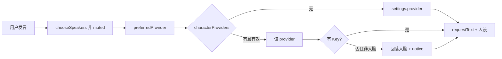

**Language / 语言 / 言語:** [简体中文](HANDOFF-HOUSE-BRAIN.zh-CN.md) · [English](HANDOFF-HOUSE-BRAIN.en.md) · [日本語](HANDOFF-HOUSE-BRAIN.ja.md) · [Index](HANDOFF-HOUSE-BRAIN.md)

# 交接：小屋大脑 · 假扮代言 · 今日在场

日期：2026-11-04  
规划依据：会话计划「单脑驱动全员 · 假扮与减员」  
相关：[HANDOFF-COMPANION-BRIDGE.md](HANDOFF-COMPANION-BRIDGE.md)（陪伴/插件桥总交接）

## 产品结论（先读这个）

- **不是**「七个厂商 Key 各控一个娘」。
- **是**「**一个小屋大脑**（一个服务商 + 一把 Key + 一个模型）+ **七套人设面具**」。
- Claude / GPT 等立绘与名字是同人角色；后端可以是 GLM / DeepSeek / 任意兼容端点。UI 必须诚实标「代言」，禁止假装连了官方 Claude API。
- 人不够或想省额度时：用 **今日在场** 减员（写 `muted`），不是另起一套在场状态机。

## 已实现

| 能力 | 说明 | 落点 |
| --- | --- | --- |
| 小屋大脑叙事 | 设置页标题/提示改为「一个 Key 驱动全员」；展示当前大脑 | [`src/Connections.tsx`](../src/Connections.tsx)、i18n |
| 假扮诚实标签 | API 模式下角色面板显示「由 {provider} 代言」 | [`src/main.tsx`](../src/main.tsx)、`panel.via` |
| system 诚实约束 | 代言时明确「后端是 X，勿称官方 API」 | [`electron/provider.ts`](../electron/provider.ts) |
| 今日在场预设 | `all` / `core`（xia·rin·shiori）/ `custom` → 写 `muted` | `cast-preset`、[`src/shared/cast.ts`](../src/shared/cast.ts) |
| 侧栏静音 | 单人 mute 后 `castPreset` 推断为 `custom` | `engine` `mute` |
| 角色后端覆盖 | `characterProviders[id]`；缺 Key 回落大脑并 notice | `character-provider`、`generateReply` + `sys.providerFallback` |
| 落盘恢复 | `castPreset`、`characterProviders` | [`src/shared/director.ts`](../src/shared/director.ts) |
| 单测 | 偏好解析、核心三人、mute→custom、restore | [`tests/cast.test.ts`](../tests/cast.test.ts) |

## 数据与路由



- 角色「本家」厂商映射（仅用于是否显示代言）：`characterHomeProvider`（如 `rin→claude`，`xia→deepseek`）。
- 发言 / 自主 / 争宠 / 百合 / 观影 speakers：已有路径过滤 `muted`；观影显式 speakers 也会去掉 muted。

## 如何运行 / 手测

```powershell
cd C:\Users\Someone\Desktop\DesktopPet
npm.cmd test
npm.cmd run build
npm.cmd run start   # 或 npm.cmd run dev
```

1. 设置 → 只保存 **一把** GLM（或 DeepSeek）Key + 模型 → **一键启用真实聊天**。  
2. 群聊里 @ Claude / GPT：应能流式回复；侧栏选中 Claude 时可见「由 GLM 代言」（或当前大脑名）。  
3. 今日在场 → **核心三人**：另外四人静音，不应抢麦。  
4. 高级区给某角色指定另一后端且 **不存 Key**：发言时出现回落 notice，仍由小屋大脑回答。  
5. 切回本地陪伴（demo）仍可用，无需 Key。

## 未做 / 勿扩展过头

- 不强制七把官方 Key。  
- 不做「假扮」欺骗（隐藏真实后端）。  
- 本主题不做 Live2D / 语音 / 多 Agent 编排。  
- 便携包发布、Playwright 同捆等仍见 Companion Bridge 交接。

## 关键文件

```
src/shared/cast.ts
src/shared/types.ts          # castPreset, characterProviders, actions
src/shared/director.ts       # initial + restore
electron/provider.ts         # generateReply 路由与诚实 system
electron/engine.ts           # cast-preset / character-provider / mute
electron/main.ts             # getKey + fallback notice
src/Connections.tsx
src/main.tsx                 # via-badge
src/shared/i18n/{zh-CN,en,ja}.ts
tests/cast.test.ts
```

## 给下一位

1. 按上文手测 1–5 做一次真人验收并记结果。  
2. 若文案仍让用户以为「要配齐七家 Key」，继续收紧设置页与 README 介绍。  
3. 产品主轴仍是陪伴小屋；单脑是降低接入门槛，不是改成「万能 Agent 控制台」。
