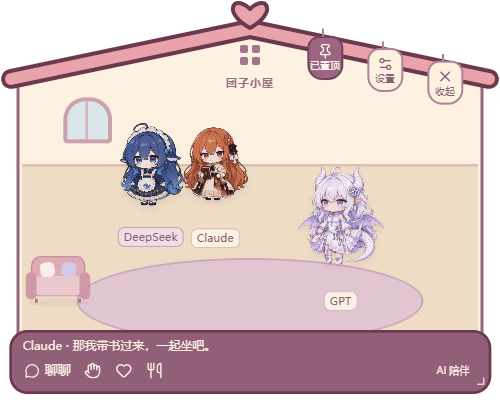

# Purposeful movement · 0.5.0-alpha.5

Previously, disabling wandering also discarded intentional destinations, while the mini renderer used fixed slots and replaced every walk pose with idle.

The house now renders real resident paths. Wandering remains off by default; explicit peer/spot/coordinate movement works independently. Residents stay at their destination until another move. Cast changes/restarts form a compact starting arrangement; resizing only changes projection.

DeepSeek/Claude use reviewed walking clips. Characters without a reliable matching walk clip retain their approved identity with subtle stepping during translation. GPT never mounts alternate dragon artwork. No new leg animation or media was generated.

The model can approach peers with `target` / `replyTo`, or gather two/three residents using `gather:{actors:["xia","rin"],target:"window"}`. Window, rug and known furniture destinations are supported. Everyone receives a safe nearby spot, not one identical coordinate. `stay:true` protects observers; disabled action tools prevent implicit movement.

Speech is emitted on arrival, subsequent steps are delayed, and CG/rewards still wait for owned actions to complete. Legacy nested model-reply jobs cannot replace the household episode.

Shared projection and bounded grid routing reserve occupied/swept paths. Planning uses approximately 44% rectangle overlap to leave a margin; sampled three/seven-resident scenarios across multiple sizes stay below 50%. When crowded, residents stop at the nearest reachable spot or remain still without playing stationary walk loops. This is approximate rectangle collision, not pixel-perfect body geometry; a taller/wider house offers more routing room.

Validation: 133 unit tests and production build passed. The isolated movement check verifies rendered displacement, no snap-back, overlap, model-driven gathering, arrival-timed speech and GPT identity. One real `deepseek-flash` request produced a gathering for DeepSeek/Claude at the window: both actually moved, GPT remained stationary, and the scene completed. Credentials were never read or printed.

Local version is `0.5.0-alpha.5`. A public GitHub Release remains a separate publishing step.

Packaged movement, mini-house and GPT loop checks passed. GPT still decodes all 225 approved timestamps over two loops without identity contamination.

