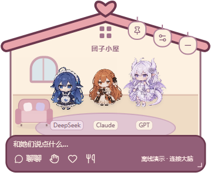

# Mini-house acceptance and handoff · 2026-11-15

Version `0.5.0-alpha.1`; see [implementation](MINI-HOUSE-IMPLEMENTATION-DRAFT.en.md).

## Results

- Unit tests: 125/125; production build passed.
- `verify-mini-house.mjs --packaged`: visible/non-overlapping roof controls, three/seven residents, group/private chat, one shared CG ending normally and window-size persistence across processes.
- `verify-house-ai.mjs --packaged`: local SSE fixture; failed connection retains demo mode, saved key is reusable with empty input, successful connection enables API mode, generated touch/feed/private greetings and private isolation. No real provider billing.
- `verify-gpt-idle-loop.mjs --packaged --house`: 225 decoded timestamps, two wraps and 115 distinct sampled images; maximum dark ratio 0.054862, below the old wrong-identity threshold 0.1; pause recovery and post-stop continuation passed.
- Real DeepSeek test in the packaged app: reused the locally saved key, connected to `deepseek-flash`, then received a model-origin `xia / deepseek / deepseek-flash` reply to a pat event with no error. No key was read, printed or committed. This verifies one real interaction, not long-term reliability, all providers or every display configuration.

The real model returned the viewer as `target: "你"`. Prompt/schema handling now removes world-space targets for user-directed gestures, uses idle for locomotion toward the viewer and still rejects unknown resident targets. A regression test covers this case.

## Running and distribution

The desktop shortcut points to `release/v0.5.0-alpha.1/win-unpacked/团子小屋.exe`. The local portable package is `release/v0.5.0-alpha.1/DangoHouse-0.5.0-alpha.1-x64.exe`; build outputs are ignored by Git. The existing public GitHub download remains alpha.5 until a new Release is explicitly published.

Roof controls are pin, settings and hide. Drag the roof, resize from the lower corner, unfold chat/setup below, and open advanced settings for cast/relationships/Dock mode.

Keep GPT's approved 225-frame idle and P1; never remount unrelated standing art. Keep demo/CG recording controls internal, and never silently substitute local dialogue for a failed model call. Next evaluate personality, repetition, latency/cost and daily usability before adding more decoration or agent capabilities. No new media generation or expanded computer permissions in this delivery.

Real packaged application using an isolated demo profile, without personal chats or credentials. Existing artwork terms still apply.
