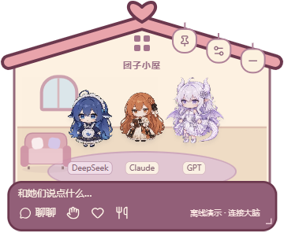

# 迷你小屋验收与接手 · 2026-11-15

版本：`0.5.0-alpha.1`。对应[实现说明](MINI-HOUSE-IMPLEMENTATION-DRAFT.zh-CN.md)。

## 验证结果

- `npm test`：125/125；`npm run build` 通过。
- `verify-mini-house.mjs --packaged`：透明房子、屋檐按钮可点击且互不重叠、三/七人切换、群聊/私聊、CG 单份播放到结束、窗口尺寸跨进程恢复通过。
- `verify-house-ai.mjs --packaged`：本地 SSE 模拟服务，连接失败保持演示、空输入复用已保存 Key、成功自动启用 API、摸头/投喂/私聊欢迎由模型路径生成、私聊隔离通过。未使用真实服务商额度。
- `verify-gpt-idle-loop.mjs --packaged --house`：225 个实际解码时间戳，2 次循环，115 个取样画面均变化；暗色比最大 0.054862，低于旧错误形象阈值 0.1；异常暂停与停止后恢复通过。
- 本机真实 DeepSeek：在打包应用中使用已保存凭证，`deepseek-flash` 握手成功，API 模式摸头事件收到 `xia / deepseek / deepseek-flash` 的模型回复，无错误。没有读取、输出或提交 Key。此结果只证明这一时刻的本机连接与一次互动，不代替长期运行、多模型或多屏测试。

真实测试发现模型会把 `target` 写成“你”；已补充提示与校验兼容：用户没有场景实体，面向用户的表情去掉空间目标，朝用户移动改为 idle，未知同伴 ID 仍拒绝。已增加对应单测。

## 运行与分发

- 本机应用：`release/v0.5.0-alpha.1/win-unpacked/团子小屋.exe`，桌面“团子小屋”快捷方式已切到这里。
- 本机便携包：`release/v0.5.0-alpha.1/DangoHouse-0.5.0-alpha.1-x64.exe`。构建输出不进入 Git。
- GitHub 公开下载仍是此前发布的 alpha.5；本轮源码版本和本机安装不等于已发布新的 GitHub Release。
- 默认主入口为迷你小屋。右屋檐：置顶、设置、收起；屋顶拖动、右下角改大小。小屋底部展开聊天或连接，更多设置进入原工作台；桌宠/Dock 仍可从高级设置启用。

## 接手注意

保留 GPT 清理后的 225 帧素材及 P1；不要重新挂载站立备用图。不要在主页面恢复试玩/直接播放 CG 按钮；内部调试命令仍供录制。不要将模型错误静默替换为本地台词。

后续先观察真实陪伴回合的个性、重复率、成本与聊天体验，再补界面装饰、动画或更复杂的自主 Agent。当前没有生成新图片/视频，也没有扩大电脑操作权限。

图为真实打包应用的隔离演示存档，无用户凭证或聊天。美术仍适用现有素材条款。
