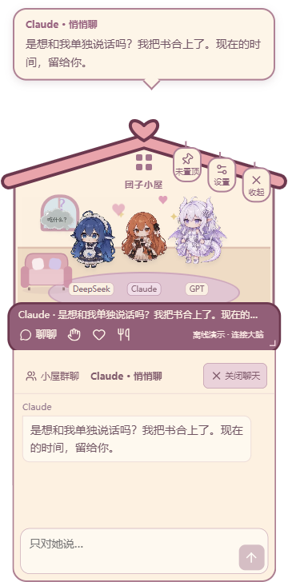
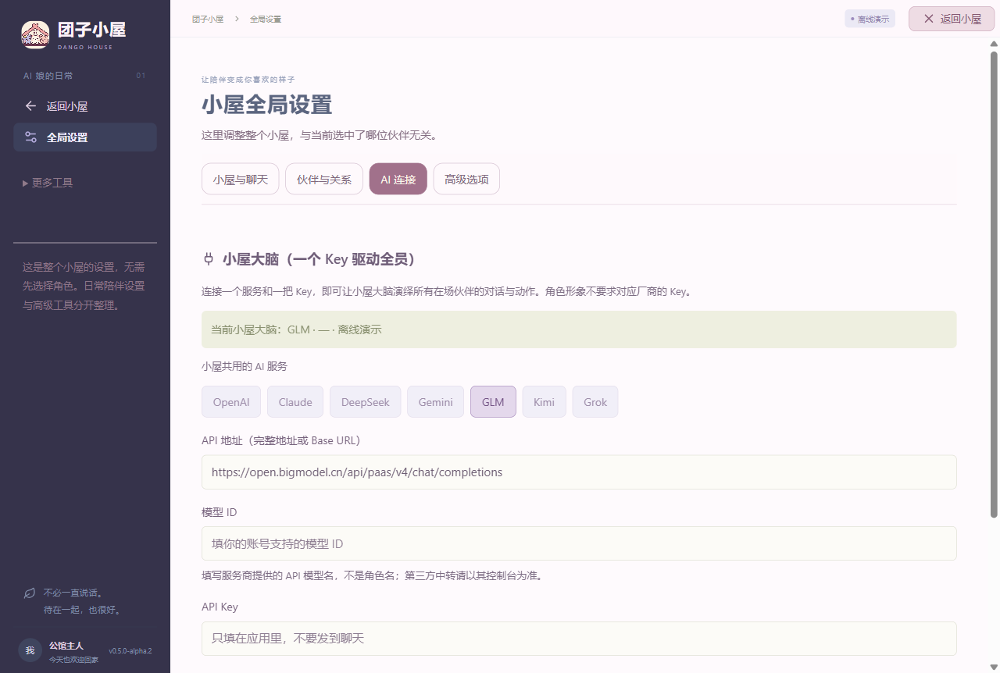

# Unified settings and speech bubbles · 0.5.0-alpha.2

The roof gear now opens one complete global settings page. Selection of a resident does not change its scope, and the settings sidebar no longer includes a resident selector.

- **House & chat:** language, reminders, autonomous life/greetings and DND. Autonomy updates both the global and room switches so a hidden second toggle cannot prevent activity.
- **Residents & relationships:** cast size, names/address, friend/pet/lover mode, independent girl–girl affection, CG and relationship tone.
- **AI connection:** the only house-brain connection form. One connection powers public household events. Test successfully before enabling API mode; empty key input keeps the saved key and failures stay explicit.
- **Advanced:** free/Dock pets, standalone chat artwork, backend overrides for individual private replies and MCP/REST integrations. Watch tools, character profiles and manual memories remain under “More tools”.

Settings has a labelled “× Back to house” control and chat has “× Close chat”. The roof’s “× Hide” only hides the house to the tray; quitting is still available in the tray menu.

Pin color, icon rotation, text and `aria-pressed` reflect Electron's actual `isAlwaysOnTop()` state. This local window preference is saved in `house-window.json` and restored across launches.

One speaker-labelled bubble appears above the house for 20 seconds; click it to open the complete chat. Private content uses its private channel. If headroom is insufficient, the base subtitle/history remain available. A shared CG has priority over the upper space rather than overlapping the bubble. Transparent empty space still passes clicks through.

The duplicate compact `HouseConnection` and unused legacy Settings implementation in `main.tsx` were removed. This supersedes alpha.1's attached compact setup panel; the shared connection helper remains.

Isolated checks cover settings entry/return, chat close, bubbles, native/UI/persisted pin state, three locales at two window widths, failed/successful setup and model-directed touch/feed/private entry. API checks use a local SSE fixture without real keys or billing. GPT media and its repaired 225-frame idle are unchanged.

Results: 125/125 unit tests, production build and all three packaged verification scripts passed. The desktop shortcut now targets `release/v0.5.0-alpha.2/win-unpacked/团子小屋.exe`. The portable build is one directory above; pushing source does not publish a new public GitHub Release.

Screenshots use an isolated demo profile without personal data.
