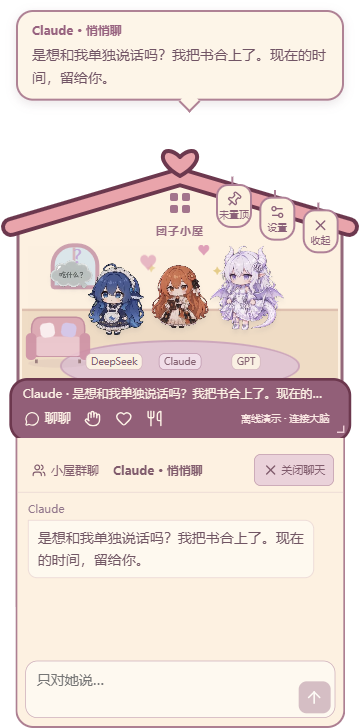
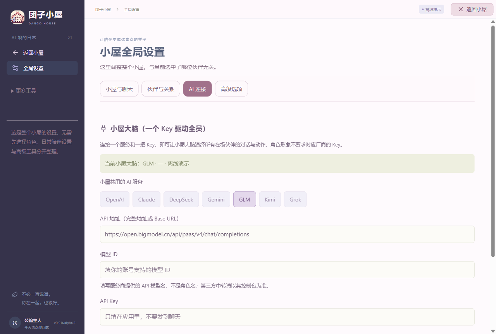

# 设置整合与气泡对白 · 0.5.0-alpha.2

本次把日常小屋、角色关系和高级能力分层，避免为同一设置保留多个表单、或让用户误以为设置只作用于当前角色。

- **屋檐设置**：直接打开完整全局设置，与选中的角色无关。侧栏不再放角色名单。
- **小屋与聊天**：语言、提醒、主动生活与问候、免打扰。主动生活开关联动全局与房间的自主开关，避免一个开着、另一个关着却看不出原因。
- **伙伴与关系**：在场人数、称呼与朋友/宠物/恋人关系、女孩贴贴偏好、CG 与互动氛围。与用户的关系、女孩之间的亲密偏好仍分别设置。
- **AI 连接**：唯一的小屋大脑配置表单。一次连接供所有在场角色的公开互动使用，测试成功才启用。空 Key 输入保留已存凭证，失败不降级伪装成 AI。
- **高级选项**：自由桌宠/Dock、独立聊天立绘、单独私聊的后端覆盖、MCP/REST 联动。看视频、角色资料和手工记忆等保留在侧栏“更多工具”，无需日常先配置。

退出设置使用带文字的“× 返回小屋”；聊天区使用“× 关闭聊天”。屋檐“× 收起”只隐藏小屋到托盘，退出整个应用仍使用托盘菜单，避免混淆。

置顶是本机窗口状态，不是角色偏好。按钮通过底色、图钉方向、“已置顶/未置顶”和 `aria-pressed` 共同反馈；与 Electron `isAlwaysOnTop()` 同步，写入 `house-window.json` 并跨重启恢复。

对白优先以小屋外上方的带名字气泡显示，每次一段，停留 20 秒；完整文本进入群聊或当前私聊。点击气泡展开记录。上方空间不足时仍保留底部短句和聊天记录；CG 播放时上方由单份 CG 占用，不叠放气泡。透明区域继续穿透鼠标。

已删除重复的 `HouseConnection` 和 `main.tsx` 中未使用的旧 Settings，实现只保留一套连接逻辑。历史 alpha.1 文档中“下方紧凑连接面板”已被本页方案替代。

验收使用 `verify-mini-house.mjs`、`verify-house-ai.mjs`、`verify-settings-layout.mjs` 的隔离 profile；不使用真实 Key、不消耗真实模型额度。覆盖全局设置进退、聊天关闭、气泡、置顶 UI/native/重启一致性、三种语言两种窗口宽度、连接失败/成功、动作与私聊模型路径。GPT 素材及其已修复的 225 帧循环不变。

本轮结果：125/125 单元测试、生产构建和以上三项打包版验收均通过。桌面快捷方式更新至 `release/v0.5.0-alpha.2/win-unpacked/团子小屋.exe`。本机便携包位于同目录上层；GitHub 公开 Release 不随源码推送自动更新。

截图来自隔离演示存档，不包含真实用户信息。
